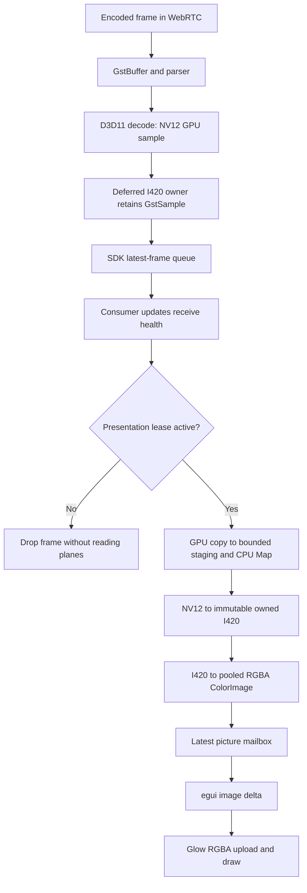
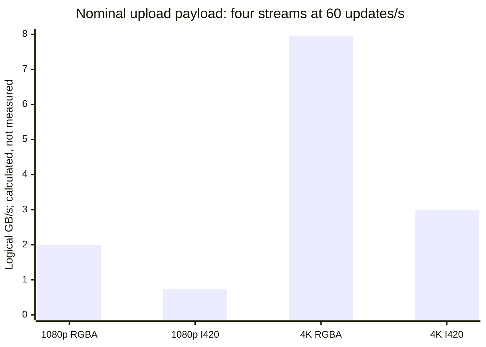

# Further performance work after the measured native pass

Research date: **2026-11-10**. Inspected checkout: `freedomstream-perf`, branch
`perf/local-experiments`, initially clean at
`e93b71d437810192bd1648e65088f1a6b9196754`. This is an independent source and evidence
investigation, **not an implementation or a new benchmark campaign**. Only this
report was written. No app, benchmark, build, deployment, or physical acceptance
test was run.

**Start with the clipped-tile presentation lease, then prototype planar video
presentation inside the existing Glow renderer.** The first has a concrete,
narrow source-level cause. The second removes an entire remaining representation
change without first undertaking D3D11/OpenGL texture interoperability or changing
UI frameworks. Neither has a measured saving yet. Investigate historical-usage
query scaling separately; it is a server workload the session-query optimization
did not address. Attribute the existing stopped-memory growth before choosing
another cache, allocator, or device-lifetime policy.

## Basis, scope, and confidence

The current [PR #19](https://github.com/Felipebmaitan/freedomstream/pull/19) was
read back as **open**, head `e93b71d…`, base `main`, with no merge timestamp during
this investigation. Reading its state was not a request to merge or deploy it.
The last commit corrects a documentation median. The native product sources are
unchanged from `000129f9153a560a38030d77f06e8a1844dbed99`; a later example-helper
change is distinct from product code. References to repository line numbers below
use the inspected revision, not the unrelated working tree in `freedomstream`.

Four evidence classes are used throughout:

- **Source fact:** directly observed code, ownership, or API contract. This proves
  that a path exists, not its time or memory cost on the host.
- **Recorded measurement:** a result already preserved in the
  [experiment ledger](../verification/local-performance-experiments.md) and
  [sanitized aggregate](../verification/local-performance-results.json). It was
  inspected here, not rerun.
- **Inference:** an explanation consistent with those facts, with alternatives
  kept explicit.
- **Proposed experiment:** unimplemented and unmeasured. A direction or byte
  accounting calculation is not a promised performance improvement.

The evidence contains 179 actual-UI runs, including excluded and unsuccessful
attempts, and 293 evidence-hash entries. I inspected selected comparison families,
the final four-4K diagnostic/capacity records, the lifecycle report, experiment
decisions, and the summarizers. I did **not** independently rehash all 293 evidence
files or reproduce the earlier reviewers' full audit. Prior approvals establish
the scope of those reviews, not the absence of further opportunities.

The recorded host is Windows 11 Pro build 26300, Ryzen 7 9800X3D, RTX 5080, NVIDIA
driver 32.0.16.2114, with a 1080p/300 Hz display and a Parsec virtual adapter. The
stack is Rust 1.95.0, eframe/egui/Glow 0.37.0, LiveKit 0.10.1, libwebrtc 0.4.0,
the pinned/customized webrtc-sys 0.3.53, and the curated GStreamer runtime. These
are the existing evidence's configuration, not a new hardware inventory.

### What was examined

| Area | Concrete source/evidence examined | What that establishes; remaining gap |
| --- | --- | --- |
| UI and presentation | `ui.rs`, `video_image.rs`, `playback.rs`; installed egui scroll/UI, texture, and Glow code | Tile demand, image ownership, handoff and upload call paths; no current GL timing or physical presentation trace |
| Hardware receive | `freedomstream_decoder.h`, `deferred_i420.h`, `bounded_readback.h`; pinned GStreamer D3D11 decoder/device/context code | Sample, staging, plane and device lifetimes; actual pool-copy frequency, device count, and Map wait distribution remain unknown |
| SDK receive boundary | Installed/pinned `video_stream.rs`, `video_frame.rs`, `video_frame_buffer.cpp`, `video_track.cpp` | Latest-frame queue and supported I420 access; no evidence that moving a wrapper necessarily copies a picture |
| Control and feedback | `publisher.rs`, playback reconciliation, per-track stats, `network.rs`, `quality.rs` | Existing bounds, desired-state checks, generations, feedback; no new control-plane CPU attribution |
| Capture and publication | `encoding.rs`, source selection, encoded-frame SDK bridge, preview gate | GPU capture/encode path, borrowed encoded payload, actual minute gate; no new game/encoder quality qualification |
| Audio and process policy | `audio/mod.rs`, `audio/windows.rs`, playback audio pipeline, prior audio/process experiments | Per-track output, queue ownership, existing exclusion and restart contracts; physical A/V and endpoint timing remain unmeasured |
| Server and SFU | `rooms.ts`, `access.ts`, `app.ts`, `usage.ts`, `admin.ts`, preview/distribution/network routes, web admin polling, custom SFU telemetry patch | Synchronous usage work, query shape, bounded telemetry; no long-history database or production contention profile |
| Portable/lifecycle | Portable reader/extractor/launcher source, retained-change ledger, lifecycle evidence | Streaming verification and bounded payload ownership already exist; stopped-memory owners have not been identified |
| Measurement | `run-app-performance-matrix.mjs`, `local-performance-room.mjs`, `summarize-local-performance.mjs`, `summarize-performance-pass.mjs`, fixture entry points | Workload/counter definitions and exclusions; aggregate counters cannot establish unique frames physically shown |

The earlier [performance](performance-opportunities.md) and
[footprint](resource-footprint.md) reports were read as historical proposals.
Where they describe pre-optimization source, the current code and measured ledger
take precedence.

## The remaining receive path

The current hardware path is substantially better than the original report's
download-plus-copy pipeline, but visible presentation still has these boundaries:

This follows [decoder Configure/Receive:24–134][decoder],
[deferred materialization:61–108][deferred], [bounded readback:19–108][readback],
[playback:574–649][playback], [image conversion/pool:14–93][image-pool], and
[UI handoff:626–644][ui]. The software AV1 path supplies SDK CPU pictures without
this custom NV12 GPU readback; it still reaches the RGBA/UI steps.

There is no additional Rust pixel-vector clone in `update_picture`: it takes the
mailbox's `Arc`. Installed Glow 0.37.0 `Painter::set_texture` casts the existing
`Color32` storage to bytes, rather than flattening it into a fresh vector. Its
full-image path then calls `glTexImage2D`. These facts rule out two tempting but
incorrect descriptions of another removable full-frame copy. The remaining
RGBA expansion and upload are real; an extra egui pixel copy is not established.
See the installed-source inventory below for the exact Glow source identity.

### What the existing numbers do and do not locate

The final four-1080p60 HEVC three-pair comparison retains approximately 240
consumer-delivered pictures/s with approximately 236 egui texture handoffs/s.
The later four-4K capacity run has 181.98 consumer-delivered pictures/s, 181.82
conversions/s and 108.71 handoffs/s in grid. Its minimized phase has approximately
240 consumer-delivered pictures/s and zero conversions/handoffs. The final
no-egui four-4K diagnostic has four hardware HEVC decoders and 3840×2160 pictures;
between samples 20 and 29, counters advance from 2,284 to 4,459, or 241.67/s using
the fixture's integer-second labels. These are **existing capacity observations**,
not a new controlled comparison.

They support investigating the visible presentation path, but do not identify
`Map`, libyuv, GL upload, driver allocation, or UI scheduling as the dominant
stage. The CLI renews presentation leases, consumes pictures only at its sampled
interval, and has different image-owner lifetimes from egui
([`main.rs`:404–452][main]). Its counters do not prove that every delivered picture
was converted or uploaded. A GPU-only or framework-specific diagnosis from this
comparison would be too strong.

The one-4K before/after runs have unequal consumer delivery and higher memory in
the selected implementation; they are not equal-work CPU wins. The whole-app
four-4K run's 2,678.57 MiB (about 2.62 GiB) of private memory is also much larger
than the calculable RGBA pool alone. Do not assign its entire footprint to one
buffer family. The ledger's physical hardware, game, and deployment limitations
remain.

## Experiment order

Ranking combines strength of cause, relevance to this app, scope, and how cheaply
the hypothesis can be falsified. It is **not** a measured ranking of bottlenecks.
S/M/L describe relative engineering and qualification effort, not time estimates.

| Rank | Experiment family | Confidence in current cost/path | Intended direction | Effort and risk | Novelty |
| --- | --- | --- | --- | --- | --- |
| 1 | Renew presentation leases only for visible video rectangles | High: unconditional call occurs before rectangle allocation | Remove readback/conversion/upload for fully clipped pictures, retaining media/audio | S–M; clipping/restore errors | Completes an unhandled visibility case; existing focus/minimize gating is already retained |
| 2 | Present supported I420 planes through a Glow video shader | High: RGBA expansion/upload remain; benefit unmeasured | Lower CPU pixel work and upload payload; possibly lower live pixel storage | M–L; color/filtering, ownership, GL lifecycle | A narrower intermediate design than the rejected native D3D11/GL bridge |
| 3 | Bound historical-usage report work | High: synchronous query fanout and polling; cost at scale unmeasured | Reduce server event-loop stalls and repeated history aggregation | M; accounting, pagination, migration/cache semantics | Different workload from the retained session-query preparation |
| 4 | Attribute and then reduce residual stopped-memory growth | High: growth was measured; cause unknown | Remove demonstrated retained owners, if found | M diagnosis; implementation depends on owner | Existing weak-registry fix and two-image policy do not explain this observation |
| 5 | Share active hardware-decoder devices per compatible adapter | High: separate pipelines and no app-provided context; actual device count unmeasured | Avoid duplicated device-level state if it is material | M–L; serialization, adapter/generation/lifetime coupling | Distinct from keeping a spare capability factory or sharing an audio sink |
| 6 | Qualify decoder output-pool retention and readback scheduling | High: source has conditional direct/copy output and synchronous Map; selected paths unmeasured | Avoid demonstrated extra copies/waits without dropping delivered work | M–L; pool starvation, latency, memory, device loss | Beyond retained one-staging-texture reuse; conditional on new attribution |

Ranks 1–2 are the most actionable native presentation work. Rank 4 is a diagnosis
that must precede a speculative memory fix. Ranks 5–6 should stop after
instrumentation if their hypothesized costs are absent or immaterial.

## 1. Fully clipped tiles still renew presentation demand

**Source fact.** `stream_tile` calls `self.update_picture(ui.ctx(), tile)` at line
791, then allocates the video rectangle at line 792. `update_picture` renews the
250 ms lease and hands off any pending image. The grid invokes `stream_tile` for
every tile inside `ScrollArea::show` at lines 1171–1194. It does not test whether
the video intersects the scroll viewport. Installed egui's `ScrollArea::show`
executes the contents closure; it is not `show_rows` virtualization. The library
provides `Ui::is_rect_visible`, which combines UI visibility and clip-rectangle
intersection. [Application UI][ui]; installed egui sources below.

**Inference.** When a narrow/short window or additional tiles require scrolling,
an entirely offscreen subscribed video continues to renew its lease, causing
conversion and texture handoff work whose output is clipped. Rendering a clipped
quad does not undo already-requested readback or texture work. This issue does
not imply a saving when all tiles already fit, and it does not invalidate the
existing focus/fullscreen/minimized savings.

**Candidate design.** Allocate the video rectangle first, then renew its
presentation demand and consume a new picture only if it is actually visible.
Treat any partial intersection as visible. Keep layout, controls, hit testing,
watch intent, audio, network subscriptions, decoded-health accounting, and
minute-preview logic unchanged. Keep the last GPU texture for quick return
initially; evicting that texture is a separate memory experiment. The existing
lease allows a bounded settling interval after a tile leaves the viewport.

This does not require changing repaint frequency, adding conversion workers,
reducing requested FPS, or pretending an unwatched stream is still subscribed.
It is narrower than the previous rejected frame-driven repaint experiment.

**Before/after experiment.** Use the same one/four/five actual subscriptions,
codec, source geometry, content, FPS, bitrate and audio. Compare a fixed wide
all-visible layout and a fixed 960×540 one-column layout, then scroll through
each tile with a repeatable schedule. Record per-tile lease-active time,
materialization/conversion/handoff/actual-upload counts, CPU, private bytes,
working set, GPU activity, and time to the first fresh picture after re-entry.
Include a one-pixel partial intersection, DPI scaling, resize, fullscreen exit,
focus exit and reconnect while scrolled.

**Acceptance and falsification.** After lease expiry, fully clipped tiles should
have zero new materializations/conversions/uploads while receive/audio counters
continue at the same workload. Visible tiles must retain update rate, freshness,
pixel output and controls; re-entry must not show a permanently frozen picture
or request a codec fallback. If baseline offscreen work is already absent in an
instrumented run, investigate egui discard/invisibility state before changing
code. No process-CPU percentage can be predicted from source alone.

**Qualification.** Locally testable on the existing host. A normal renderer test
alone is insufficient: verify through the actual native/SFU path and actual
subscription bytes. Merging this into the separate evolving UI branch would need
a fresh source review because its tile code is not this report's revision.

## 2. Remove RGBA expansion with planar presentation in Glow

**Source fact.** Each active picture calls SDK `to_argb(ABGR, ...)` into a
full-source-resolution `ColorImage`, with at most two reusable images. The UI
scales the texture to its tile only after conversion and upload. The same source
picture therefore costs full-resolution CPU pixel work even in a small tile.
The SDK exposes `as_i420()`, plane data, dimensions and strides. Its installed
I420 `to_i420()` implementation deliberately copies; a new path must not
accidentally introduce that copy just to obtain a planar owner.
[Image pool][image-pool], [UI][ui], [SDK frame access][sdk-frame], installed
libwebrtc source below.

**Candidate design.** Preserve `DeferredI420Buffer` and its supported ownership
contract. Materialize planes away from the GUI thread, then move an immutable
owned frame through a bounded, generation-specific latest-picture mailbox. A
Glow paint callback uploads Y, U and V to plane textures and converts to RGB in a
shader. Keep the existing RGBA path as the compatibility/reference path. Glow's
installed `CallbackFn` receives the painter/context and supports a `Send + Sync`
closure; no new UI framework or native runtime family is needed merely to test
this design.

Use an owned SDK frame/plane owner rather than saving borrowed plane pointers.
For the existing I420 buffer type, `as_i420().data()` can borrow its planes while
the owner lives. Do not call `to_i420()` unconditionally. Resolve deferred GPU
materialization before the GUI callback, otherwise the experiment moves blocking
`Map` onto the UI thread. Retain generation isolation and explicit release of
GL resources on the owning context. Initially use ordinary bounded plane uploads;
PBO rings, persistent mapping and native texture import are separate variables.

**Defensible bound: logical payload, not measured bus traffic.** For even source
dimensions `W × H`, opaque RGBA contains `4WH` bytes and 8-bit I420 contains
`WH + 2(W/2)(H/2) = 1.5WH` bytes. Tight I420 uploads have **62.5% fewer logical
bytes** than RGBA. Actual stride padding, GL/driver copies, allocation, CPU caches,
and GPU traffic are not included. At a nominal four streams × 60 updates/s:

| Source size per stream | RGBA payload per update | I420 payload per update | RGBA payload/s for four streams | I420 payload/s for four streams |
| --- | ---: | ---: | ---: | ---: |
| 1920×1080 | 8,294,400 B | 3,110,400 B | 1.991 GB/s | 0.746 GB/s |
| 3840×2160 | 33,177,600 B | 12,441,600 B | 7.963 GB/s | 2.986 GB/s |

These are arithmetic at the nominal update target, not observed transfer rates.
They do not say the RTX 5080 or PCIe link is bandwidth-saturated. The existing
two-image RGBA pool has up to `8WH` logical pixel bytes per stream: 15.82 MiB at
1080p or 63.28 MiB at 4K. Four 4K streams account for 253.13 MiB in those pool
pixels. This is a removable representation's budget, **not a net RAM saving**:
the candidate retains I420 owners, GL textures and possibly different decoder
buffers, and allocator/driver commit may not immediately fall.

**Why this is new enough to test.** The first pass already eliminated the
intermediate RGBA vector and per-pixel `ColorImage` construction; those savings
cannot be counted again. R01 explored a GPU-resident D3D11 presenter/SDK surface
lease, leaving complete GL import/synchronization unqualified. The planar design
keeps the already supported CPU-plane boundary and removes the next expansion.
It still pays GPU readback and NV12-to-I420 materialization. R05's partial RGBA
texture update results and I420 allocation pool do not test this change in
pixel representation. An isolated native presenter is not its performance proof.

**Color and filtering are the main correctness risk.** The current reference is
the pinned libyuv conversion followed by egui's RGBA texture/color path. A shader
must preserve channel order, opaque alpha, source range/matrix handling, chroma
siting, odd/padded dimensions, orientation, and the framebuffer's sRGB behavior.
Linear filtering of YUV planes followed by conversion is not automatically
identical to the current converted-RGB filtering, especially with chroma
subsampling and nonlinear transfer functions. Match the reference's displayed
output; do not casually substitute a different color matrix as a performance
change. Source color metadata improvements would be a separate correctness task.

**Before/after experiment.** First compare every pixel against the current path
at 1:1 scale, then compare rendered offscreen outputs at the exact grid/focus/
fullscreen sizes with color bars, dark gradients, saturated edges, small text,
one-pixel motion, odd strides and changing dimensions. Define permitted
quantization tolerance before measuring speed. Then run actual one/four-stream
1080p60 and one/four-stream synthetic 4K H.264, HEVC, hardware AV1 and software AV1
through the same SDK/SFU, with the same presentation policy and controlled
source frames. Separate first-use shader compilation from steady state.

Measure CPU time in materialization/conversion, GUI submission and GL upload;
logical bytes passed to GL; GL/GPU elapsed work where supported; process commit,
resident memory and GPU budgets; unique-frame delivery and age; visible update
rate; audio continuity; and game-contention countermetrics. A faster CPU path
that shifts enough work to 3D to worsen the game is not a win for FreedomStream.
At 4K, require equal delivered work before reporting a CPU reduction. Keep
per-run values and compare both equal-work efficiency and maximum sustainable
capacity as separate questions.

**Stop condition.** Reject if output equivalence, bounded ownership, UI
responsiveness, cross-codec fallback, or actual visible throughput regresses. If
the result is good only on one driver, keep it experimental pending qualification.
The existing RTX host can test the local hypothesis. AMD/other GPU generations,
adapter changes, and physical 4K120 remain separate gates.

## 3. Historical usage can monopolize the API event loop

**Source facts.** `Usage` opens `DatabaseSync`, records every five seconds, and
keeps 400 days. `report()` performs coverage aggregation, total/distinct-user
aggregation, a sorted user-page aggregation, a global time series, and a separate
time-series query for each returned user: **up to 28 SQL executions for a 24-user
page**. It builds these statements per call. Each series is bounded to about 240
output points, but rows examined are not bounded by that output size.
[Usage:66–88, 126–201, 215–284][usage].

The admin route accepts up to 366 days and calls this method after checking
current admin authentication. The visible admin tab polls every five seconds,
including for a fixed historical range; its pending guard prevents overlap in
that tab, not across tabs/clients. [Admin route:103–125][admin],
[admin UI:226–267][admin-ui]. Node 24.11.1 documents that `DatabaseSync` APIs are
synchronous. The `async` HTTP handler does not make this SQL asynchronous.
[Node SQLite][node-sqlite].

**Inference.** Long history and repeated admin refreshes can delay unrelated
admission, media-token, preview, and paced-test work sharing the event loop. The
existing primary key `(minute,user)` and index `(user,minute)` are useful; this
is not a claim of missing indexes or an unconditional full-table scan. The exact
plan, temporary sorting, I/O and wall time must be measured. As an illustrative
row-count model, five simultaneously active participants for four hours/day over
400 days yield 480,000 participant-minute rows before session/churn differences.
That is arithmetic, not an inspected user database or a production estimate.

**Candidate sequence.** Start with prepared statements and a measured query
rewrite, preserving the full response. Derive values from one shared aggregation
where valid; obtain the paged users' bucket values together only if the query
plan avoids processing an unnecessarily large all-user intermediate. Evaluate
covering indexes against their write/storage cost, using SQLite's query-planner
and [EXPLAIN QUERY PLAN](https://www.sqlite.org/eqp.html) guidance. Do not assume a
large `GROUP BY` or CTE is faster merely because it is one statement.
[SQLite query planning][sqlite-planner].

If query work is still material, compare incremental closed-bucket summaries or
a bounded report cache, then a report worker with its own read connection.
Cache only report data, with explicit write/range invalidation; re-evaluate
freshness/availability fields and authenticate every HTTP request. Never cache a
positive room/session/media authorization decision. A worker preserves event-loop
responsiveness but does not remove SQL CPU, disk work or WAL/lock costs. `Rooms`
already enables WAL; blindly enabling it again is not a new optimization
([`rooms.ts`:48–50][rooms]). Keep backup/restore and retention migrations reviewable.

**Before/after experiment.** Generate a synthetic database, never copy real room
or invitation data. Cover small/five-person usage, 30/366-day ranges, many sessions
with equal display names, 24+ users and later pages, sparse traffic, minute edges,
SFU restart/reset and coverage gaps. Compare every response field: totals,
distinct users, deterministic ordering/ties, all buckets, coverage, page bounds,
retention and freshness. Existing correctness tests exercise several of these
semantics but are not long-history performance fixtures.

With fixed report requests and a separate load-generator process, measure server
CPU, event-loop delay p50/p95/p99, report latency, concurrent admission/token/
preview latency, SQLite rows/plans, file/WAL size, write duration and backup time.
Use the same data, result pages and successful request count in each variant.
Run one and several visible admin clients. Reduced response detail or a slower
poll cadence must not masquerade as query efficiency. Local tests can falsify the
SQL/event-loop hypothesis; actual shared-VPS headroom needs deployment testing.

**Novelty.** R17 optimized three repeated authority statements and an immutable
network upload block. It did not establish the cost of these history reports.
Its failed SFU coalescing experiment is a reason to preserve fresh authorization,
not a reason to avoid carefully keyed, admin-only derived report data. At a small
fresh database this work may have negligible payoff; keep the result negative if
the long-history fixture shows no meaningful competing-request penalty.

## 4. Identify the owners behind stopped-memory growth

**Recorded measurement.** Across seven cycles, the settled stopped private-memory
endpoints rise from 237.02 to 314.60 MiB in the baseline and 261.12 to 339.07 MiB
in the selected build. These are approximately 78 MiB increases in **both**.
Handles and threads do not monotonically grow, and media delivery stops. This is
neither proof of a leak nor proof of a plateau. It is a stronger reason to
identify owners than to add another global memory pool.
[Lifecycle ledger](../verification/local-performance-experiments.md#repeated-lifecycle-and-cleanup).

**Source facts to instrument.** `Pump::drop` aborts a task; it does not synchronously
prove its destructor has finished. A synchronous conversion already underway
cannot be interrupted, which is why a replacement pump owns fresh mailboxes.
`suspend` intentionally preserves watch intent. Deferred frames retain the sample
and readback generation until materialized or destroyed; materialization releases
the sample. `Decoder::Stop` nulls the pipeline, releases elements and the generation
readback owner. UI textures and preview pictures have their own owners. None of
these observations demonstrates an unbounded reference cycle.
[Playback:164–180, 258–269, 698–701][playback], [deferred:24–116][deferred],
[decoder:95–104][decoder], [UI:856–859][ui].

**Experiment, before any fix.** Add diagnostic-only live/high-water counts and
bytes for decoder generations, GstSamples, staging textures, materialized I420,
RGBA pool images, mailbox images, GL textures and completed pump destructors.
Correlate them with heap allocation stacks, private committed regions and DXGI
local/nonlocal memory. Process private bytes and working set alone cannot assign
memory to Rust, WebRTC, GStreamer, driver caches or heap slack. Do not subtract
GPU memory counters from process commit as if these accounts were disjoint.

Compare longer fixed Watch/Stop sequences, Leave/rejoin sequences, a single
uninterrupted session, one versus four streams, and controlled geometry changes.
Observe at consistent timepoints after **destructor completion**, with later
settling samples as well as the existing 15-second window. Preserve thumbnails
and expected connection owners in the expected-live baseline. Distinguish
monotonic live allocations from retained heap capacity, lazy caches, driver
allocation and page residency. Instrumented attribution runs are separate from
uninstrumented performance comparisons because tracing changes timing and memory.

Only then choose a narrow fix: release an identified obsolete owner, cap a
demonstrated cache by lifecycle/geometry, or qualify a different allocator policy
if heap-retention evidence actually supports it. Measure both steady churn and
next-start latency; aggressive reclamation that reallocates every frame can make
game tails worse. Do not force working-set trimming, reduce heaps blindly, remove
the supervision wrapper, or claim the existing weak-track pruning retained media
frames—it removed expired weak metadata.

**Novelty and limits.** This is a new attribution task motivated by an unresolved
measured result, not a newly discovered leak or a claim that the selected change
caused the growth. The same-build controlled memory experiments can run locally.
Long group sessions, fresh PCs and other driver families remain unqualified.

## 5. Share only active, adapter-compatible decoder devices

**Source facts.** Each `Decoder::Configure` creates a separate GStreamer pipeline.
The application does not inject a shared D3D11 `GstContext` into these pipelines
([decoder:24–44][decoder]). In the pinned GStreamer source, the decoder accepts
an adapter-LUID-matching context; its device helper queries surrounding elements
and the application and creates a new device if none is obtained. Device creation
ultimately reaches `D3D11CreateDevice`. There is no application-level cross-pipeline
context provider in the inspected receive path. This supports an expectation of
separate device ownership; it is not a measured device count.
[H.265 context handling:110–140][gst-h265],
[context helper:317–505][gst-context], [device construction][gst-device].

**Hypothesis.** Device-level objects, driver state and contexts may be duplicated
across watched streams. A device shared by currently active compatible decoders
could reduce that cost and reconnect churn. Codec reference surfaces and
per-stream decoders would still exist; do not divide total VRAM by four and call
the remainder recoverable. Drivers may already share much of their internal
state, making the return small.

**Critical competing effect.** `BoundedReadback::Copy` takes the GStreamer device
lock around copy and blocking `Map`. The pinned device API requires serialization
of its immediate-context access. Sharing a device can therefore turn currently
independent waits into contention across streams. The retained R20 change already
narrowed this lock after a regression; this proposal must not undo that result.
[Readback:62–106][readback], [GStreamer device locking][gst-device].

**Before/after experiment.** First record only sanitized process-local device
identities/counts, adapter LUID equivalence, creation/destruction counts and
per-device memory, using an instrumentation build. If the paths already share a
device or creation/state costs are immaterial, stop. Otherwise compare existing
ownership to an active-session owner keyed by adapter and compatible creation
requirements, supplied before pipelines start. Keep it bounded to live decoders;
do not retain a spare permanent device merely to avoid a future constructor.
Leave capture/encoding device policy unchanged in the first experiment.

Use one/four same-codec and mixed-codec subscriptions, visible and minimized,
simultaneous publish/watch, Stop/rewatch and reconnect. Measure CPU, private/GPU
memory, device-lock wait, Map wait, decode/consumer delivery, actual uploads,
frame age and recovery time. A lower memory count with worse serialization or
frame deadlines is not a win. Exercise old-generation frames surviving replacement
and release of the last decoder. Fault-injection tests can test cleanup logic;
they do not qualify physical adapter/device removal.

**Novelty.** This is different from R16's rejected retained capability factory,
which would keep an extra runtime for a small occasional probe, and R11's rejected
audio-device mixer. It targets repeated active video devices. It neither shares
authority/cookie state nor requires D3D11/GL texture import. NVIDIA-local evidence
cannot qualify AMD, integrated/discrete combinations, remote-desktop adapter
changes, or other driver generations.

## 6. Measure output-pool copies and readback waits before changing them

This is a two-stage investigation, not a recommendation to enlarge every queue.

### 6a. Decoder output allocation is affected by retained samples

**Source facts.** The custom decoder's appsink has `max-buffers=2`, but a pulled
sample can remain owned by the deferred SDK frame. That appsink bound does not
bound all decoder/reference/SDK/consumer-held surfaces. The pinned GStreamer
decoder may return its decoded view directly or allocate/copy an output. With
no downstream pool proposal it reserves a default margin of four; the choice
also depends on texture-array mode, crop/size and outstanding surfaces. It may
copy when its bounded pool approaches full. [Custom pipeline][decoder],
[deferred ownership][deferred], [GStreamer allocation/output:1590–1613,
1898–1927, 1978–2037][gst-decoder].

**Inference and experiment.** The deferred design could shift pressure from CPU
staging caches into longer GPU-sample retention. This might trigger an extra
GPU-to-GPU copy, or the direct path might already work almost always. Count the
actual direct/copy decisions, allocated/pending surfaces, oldest held-sample age,
and their owners before altering allocation negotiation. A sampled “Copy engine
0%” is not proof that these copies do not exist.

If fallback copies correlate with demonstrated retention pressure, compare a
correctly sized downstream allocation proposal or earlier release after plane
materialization. Establish the maximum relevant simultaneous owners: appsink,
SDK queue, consumer, queued rendering callbacks and WebRTC internal scheduling.
Do not advertise a bound of one merely because the SDK's latest-frame queue is
one. Do not force pool waiting with an undersized declaration or remove required
codec reference surfaces. Verify whole-plane equivalence, per-stream fairness,
frame delivery, latency, memory high-water and teardown across stalls, geometry
changes and H.264/HEVC/AV1. The gain must exceed extra allocated surfaces.

This extends the old report's general pool caution with a specific allocation
contract to measure. It does not rebrand R19's deferred ownership or R20's bounded
staging as new work, and it is not evidence that today's decoder is always
copying. It is locally testable on NVIDIA; array mode and codec/driver differences
make cross-vendor validation essential.

### 6b. One staging texture still has a CPU/GPU synchronization point

**Source fact.** `BoundedReadback::Copy` calls `CopySubresourceRegion` and immediately
`Map(..., D3D11_MAP_READ, 0, ...)`. The device lock covers both calls; the pixel
conversion happens after that lock is released. Microsoft's Map contract permits
waiting for a busy resource and provides `DO_NOT_WAIT` as an explicit alternative.
Thus a wait is possible, not established as long or dominant here.
[Readback:67–107][readback], [Microsoft Map][d3d-map].

First measure CPU time separately from blocked wall time in device-lock acquisition,
GPU copy submission, Map and NV12-to-I420 conversion, with lightweight summaries.
Use [GPUView](https://learn.microsoft.com/en-us/windows-hardware/drivers/display/using-gpuview)
only as a controlled later attribution tool if those summaries warrant it. Do
not infer CPU cost from elapsed Map time alone.

If waits materially block the application, test a tightly bounded preparation
stage or a two-slot staging pipeline against the **current** one-slot design.
Only eligible, presentation-demanded frames should trigger copies. Preserve frame
timestamps and generation/device ownership, and make queue age a hard observation.
An immutable I420 plane accessor cannot become an asynchronous “not ready” API;
preparation must complete before exposure or retain a correct synchronous fallback.
A `DO_NOT_WAIT` failure must not expose stale/uninitialized pixels or spin the CPU.

Additional staging increases memory and can add latency; copying ahead can also
waste work on frames superseded before presentation. Compare same unique delivered
frames, Map/lock waits, steady CPU, frame-age tails, GUI responsiveness, audio and
GPU memory, under one/four streams and controlled GPU contention. If improvement
comes from more buffering, lower update rate, reset/dropped decoded work, or worse
audio/game tails, reject it. The old two-blocking-worker, extra-image and compressed
reset experiments already demonstrated why these countermetrics matter; they do
not establish the outcome of this different copy/preparation schedule.

Do not combine this experiment with shared-device ownership initially. Otherwise
one change's serialization may mask the other's benefit or regression.

## Measurement changes that make those experiments reviewable

These are experiment requirements, not permission to change production behavior
or a claim that existing acceptance evidence is invalid.

1. **Name counters at their actual boundaries.** `frames` increments after
   `NativeVideoStream::next`, before the presentation gate
   ([playback:574–602][playback]). It measures consumer delivery, not every hardware
   decoder output or physical presentation. `converted` counts a published
   `ColorImage`; `uploaded` increments in `update_picture` before egui/GL work
   ([playback:60–64][playback], [UI:626–644][ui]). The aggregate field named
   `textureUploadsPerSecond` is therefore an egui handoff counter. Add distinct
   counts/timings for SDK arrival/drop, materialization, conversion, mailbox
   replacement, actual GL upload, draw and present where available. UI invocation
   intervals cannot substitute for video-frame age or display cadence.
2. **Use generation-local frame identities.** Count unique current pictures at
   each boundary. Report duplicates, overwritten pictures and drops by stage;
   sum-by-time counters alone can hide stale/frozen output. Export only aggregate
   synthetic-fixture timings and counts, not media, raw SDK logs or invitation/
   session values. Separate enqueue age from capture/network/physical latency.
3. **Keep two questions separate.** Equal-work efficiency fixes codec, content,
   encoded bitrate, source geometry/FPS, subscriptions, audible channels, tile
   rectangles and delivered unique frames. Capacity testing deliberately finds
   saturation. Compare resource efficiency at an equal feasible workload before
   claiming a faster saturated configuration. Never normalize away a loss of
   displayed quality or frame deadlines.
4. **Measure ownership as well as allocation rate.** Count live and high-water
   CPU/GPU resources by generation. A smaller allocation rate can mean a larger
   live pool. An allocation freed by the app can leave process commit resident;
   a smaller working set can mean paging rather than a better footprint. Report
   private bytes, working set and DXGI budgets separately.
5. **Use matched trials and explicit countermetrics.** Alternate order, keep
   content and external helpers fixed, warm up compilation/decoder/driver caches,
   preserve individual values, and extend promising short results beyond several
   minutes. Do not attribute combined gains to one change. Separate instrumented
   diagnostic runs from final ordinary release measurements. Record per-stream
   delivery/freshness, UI/control tails, audio queue/underruns, actual Stop traffic,
   preview capture cadence, codec changes and failures alongside CPU/memory.
6. **Measure game interference with fixed work.** The existing unpaced synthetic
   GPU-load test delivered different amounts of load work and is not a game-FPS
   comparison. A future fixed scene/game comparison needs the same scene,
   settings, source, run duration, load work, driver and thermal context, with
   p95/p99 frame times. No such new comparison was executed here.

For non-media server tests, use separate client/server processes, fixed successful
requests/results and concurrent control traffic. For every experiment, preserve
the established explicit-subscription, source-derived audio/exclusion, generation,
memory-initialization and fresh-authority contracts. Continue start/at-most-once-
per-minute preview capture. Do not increase captures to drive a benchmark.

## Negative findings and ideas not promoted

The following checks limit the recommendations; they are not a generic list of
things to rewrite.

| Area | Finding and consequence |
| --- | --- |
| Another RGBA copy | The app already writes directly into final `ColorImage` storage; Glow casts that storage. Optimize the representation/boundary, not a nonexistent Rust copy. |
| More image caches / partial updates | Three images cost RAM; one-image variants lost updates in the final combination; partial GL uploads were inconsistent. Repeating those as defaults has no new justification. Planar storage changes the hypothesis. |
| Framework replacement | No complete GPUI/WGPU-vs-Glow app comparison exists. A framework swap alone does not remove decoded CPU planes. The narrower planar experiment is falsifiable without making a framework-speed claim. |
| Generic conversion workers/repaint | Prior complete-app results reject the tested two-worker and frame-driven policies. The clipping fix does not require them. Revisit only with per-stage waiting evidence and equal visible work. |
| Software AV1 global caps | Earlier fixed fixtures favor fewer dav1d threads, but varied-content deadlines and fairness remain unqualified. Keep this as an unresolved prior hypothesis, not a new discovery or universal cap. |
| Capture/presets/pacing | Current publication stays on GPU through capture/conversion/encoding. The preview probe drops buffers before preview conversion/download/JPEG. WGC's imagefreeze maintains static-window/late-keyframe behavior. Existing preset/DXGI/WGC/clocksync trials did not justify a default change. [Encoding:139–241][encoding]. |
| Encoded payload copy | Current Rust publication borrows the mapped GStreamer payload. The SDK then creates owned encoded bytes for asynchronous use. An owned GstBuffer bridge could avoid that copy, but it requires a new lifetime boundary and targets compressed bytes, not RGBA-sized traffic. No measured bottleneck justifies prioritizing it. [Encoding:427–466][encoding], [SDK capture bridge][sdk-track]. |
| Audio sharing and process caching | Shared output and process-image caching were already tested with insufficient return/qualification. Do not weaken process freshness, capture exclusions, restart/silence behavior or per-track volume to reduce threads. Physical A/V remains a separate gate. |
| Tokio/ADM/logging/snapshots | Whole-app Tokio caps, ADM gating and logging changes did not establish meaningful benefit; the large snapshot-clone fixture was already very cheap. Thread count, timer count and microbenchmarks alone do not establish a game benefit. |
| Portable size/runtime pruning | Streaming verification and early bundle release already exist. Startup and waiting savings must not be added together. Runtime/DLL pruning or EXE compression is not established resident-memory optimization; preserve offline integrity, notices and child supervision. |
| Authority/SFU caching | A controlled stale-positive unpublish race rejected SFU coalescing. Session queries already prepare statements while evaluating current authority. No new positive authorization cache is proposed. |
| Telemetry collector lock | The custom SFU collector emits Prometheus metrics while holding its map mutex; recording uses the same mutex. It could snapshot bounded rows under lock and emit outside it. The patch records from an enqueued telemetry callback, not directly on every RTP packet. At a few friends this may be negligible; profile telemetry backlog/lock hold before changing it. [Collector and patch][sfu-collector]. |
| Compressed recovery queues | Byte/age/drop/reset experiments cannot claim savings by delivering fewer frames. No new compressed-frame-dropping policy is recommended. |

The pool/readback investigations above should also be discarded if actual
instrumentation shows their costly branches are rare. Keeping a negative result
is preferable to adding device-lifetime and synchronization complexity without a
whole-app return.

## Local feasibility and external gates

| Can be investigated locally on the recorded host | Still requires additional acceptance |
| --- | --- |
| Clipped rectangles, resize/restore, actual SDK/SFU subscriptions/audio, synthetic source identity/cadence | Physical group use and long gameplay with friends |
| Shader equivalence at known source/output sizes; H.264/HEVC/AV1 hardware and forced software AV1; synthetic 4K | AMD/AMF/RX 7600, other GPU generations, physical 4K120 source/display |
| Device count, sample lifetime, staging waits, same-adapter context experiment | Integrated/discrete and multi-GPU behavior, real device removal, additional drivers/remote-display configurations |
| Extended lifecycle owner counts and matched heap/GPU attribution | Fresh physical PCs, other operating systems, deployment/runtime interaction beyond the documented host |
| Synthetic SQLite history and concurrent local HTTP workloads | Shared-VPS contention, WAN/TURN/TLS conditions and actual deployment capacity |
| Queue/timestamp/fixture-level A/V observations | Physical display-to-speaker synchronization and endpoint changes |

The existing RTSS/deep-cache failure is a compatibility limitation, not a measured
resource win or an authorization to alter overlay settings. Normal-cache portable
acceptance does not qualify arbitrary injected-hook/path combinations. Nothing
in this research closes the AMD/Siege, fresh-machine, physical A/V, 4K120 or field
gates, and nothing changes the application's MIT-compatible-code/runtime-license
requirements.

## Source identities and reproduction notes

Repository links below are immutable at the inspected commit. The experiment
ledger and aggregate are relative links for ordinary repository navigation; use
their `e93b71d…` versions to reproduce this investigation. Reproduction of the
research means reading source/evidence, not rerunning or editing private local
configuration.

The pinned installed egui/Glow source was available locally, but its attempted
public commit/docs.rs URLs were unavailable to the web reader. Its claims above
are based on the actual installed package source, not an assumed current upstream
`main`. Package versions/checksums are recorded in [Cargo.lock](../../Cargo.lock).
Paths in this table are relative to
`C:/Users/Felipe/.cargo/registry/src/index.crates.io-1949cf8c6b5b557f/`:

| Installed source | Relevant lines | SHA-256 of inspected file |
| --- | --- | --- |
| `egui_glow-0.37.0/src/painter.rs` | 108–124 callback; 510–535 byte cast; 538–629 texture upload | `fbebbfb983c2100993a2351a8513c675fe3ec6a099067993a192bedc5030140d` |
| `egui-0.37.0/src/containers/scroll_area.rs` | 1060–1069 show; 1087 show_rows; 1124–1159 viewport contents | `c7ca18425e8edcef2f31df1ebedcd7bc256004e15c752212e07d9b070aea5160` |
| `egui-0.37.0/src/ui.rs` | 689–695 rectangle visibility | `462f8e767c3313c5bc1c7384355e7a27b5fa3f5e8a20f3acd78c36944e6453e1` |
| `libwebrtc-0.4.0/src/native/video_frame.rs` | 122 conversion macro; 315–324 I420 copy conversion; plane accessors | `7d4d907c77283bbccb91b7cd8fdf006764f22c75687edf158df85693b09ea0c0` |

The installed egui package metadata names source revision
`7c0b40402271e8d40cda69f87cf3c2617c2e4382`; SDK package metadata names
`88705b15086ecbe2c26ee91ede6203f974a0fc62`. Installed SDK files can contain
experiment additions, so line offsets need not match the public source exactly.
The GStreamer source revision comes from
[deploy/portable-runtime.json](../../deploy/portable-runtime.json):
`202e42fa1bbff4ed61e08d47202db5c744987f0c`. This identifies the source used for
analysis, not a fresh binary or hardware attestation.

[ui]: https://github.com/Felipebmaitan/freedomstream/blob/e93b71d437810192bd1648e65088f1a6b9196754/apps/publisher/src/ui.rs#L626
[playback]: https://github.com/Felipebmaitan/freedomstream/blob/e93b71d437810192bd1648e65088f1a6b9196754/apps/publisher/src/playback.rs#L30
[image-pool]: https://github.com/Felipebmaitan/freedomstream/blob/e93b71d437810192bd1648e65088f1a6b9196754/apps/publisher/src/video_image.rs#L14
[decoder]: https://github.com/Felipebmaitan/freedomstream/blob/e93b71d437810192bd1648e65088f1a6b9196754/apps/publisher/decoder/freedomstream_decoder.h#L24
[deferred]: https://github.com/Felipebmaitan/freedomstream/blob/e93b71d437810192bd1648e65088f1a6b9196754/apps/publisher/decoder/deferred_i420.h#L24
[readback]: https://github.com/Felipebmaitan/freedomstream/blob/e93b71d437810192bd1648e65088f1a6b9196754/apps/publisher/decoder/bounded_readback.h#L19
[encoding]: https://github.com/Felipebmaitan/freedomstream/blob/e93b71d437810192bd1648e65088f1a6b9196754/apps/publisher/src/encoding.rs#L139
[main]: https://github.com/Felipebmaitan/freedomstream/blob/e93b71d437810192bd1648e65088f1a6b9196754/apps/publisher/src/main.rs#L404
[usage]: https://github.com/Felipebmaitan/freedomstream/blob/e93b71d437810192bd1648e65088f1a6b9196754/apps/server/src/usage.ts#L66
[rooms]: https://github.com/Felipebmaitan/freedomstream/blob/e93b71d437810192bd1648e65088f1a6b9196754/apps/server/src/rooms.ts#L48
[admin]: https://github.com/Felipebmaitan/freedomstream/blob/e93b71d437810192bd1648e65088f1a6b9196754/apps/server/src/admin.ts#L103
[admin-ui]: https://github.com/Felipebmaitan/freedomstream/blob/e93b71d437810192bd1648e65088f1a6b9196754/apps/web/src/Admin.tsx#L226
[sfu-collector]: https://github.com/Felipebmaitan/freedomstream/tree/e93b71d437810192bd1648e65088f1a6b9196754/deploy/livekit-usage
[sdk-frame]: https://github.com/livekit/rust-sdks/blob/88705b15086ecbe2c26ee91ede6203f974a0fc62/libwebrtc/src/video_frame.rs
[sdk-track]: https://github.com/livekit/rust-sdks/blob/88705b15086ecbe2c26ee91ede6203f974a0fc62/webrtc-sys/src/video_track.cpp
[gst-decoder]: https://github.com/GStreamer/gstreamer/blob/202e42fa1bbff4ed61e08d47202db5c744987f0c/subprojects/gst-plugins-bad/sys/d3d11/gstd3d11decoder.cpp#L1590
[gst-h265]: https://github.com/GStreamer/gstreamer/blob/202e42fa1bbff4ed61e08d47202db5c744987f0c/subprojects/gst-plugins-bad/sys/d3d11/gstd3d11h265dec.cpp#L110
[gst-context]: https://github.com/GStreamer/gstreamer/blob/202e42fa1bbff4ed61e08d47202db5c744987f0c/subprojects/gst-plugins-bad/gst-libs/gst/d3d11/gstd3d11utils.cpp#L317
[gst-device]: https://github.com/GStreamer/gstreamer/blob/202e42fa1bbff4ed61e08d47202db5c744987f0c/subprojects/gst-plugins-bad/gst-libs/gst/d3d11/gstd3d11device.cpp
[node-sqlite]: https://nodejs.org/download/release/v24.11.1/docs/api/sqlite.html#class-databasesync
[sqlite-planner]: https://www.sqlite.org/queryplanner.html
[d3d-map]: https://learn.microsoft.com/en-us/windows/win32/api/d3d11/nf-d3d11-id3d11devicecontext-map
