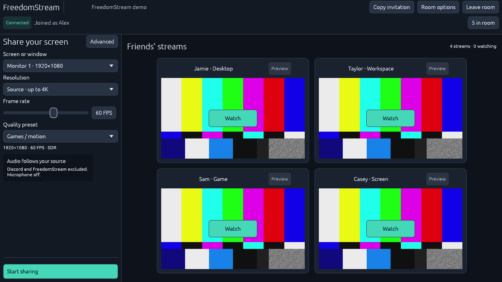
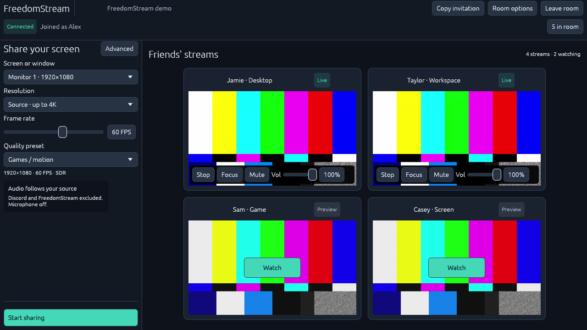
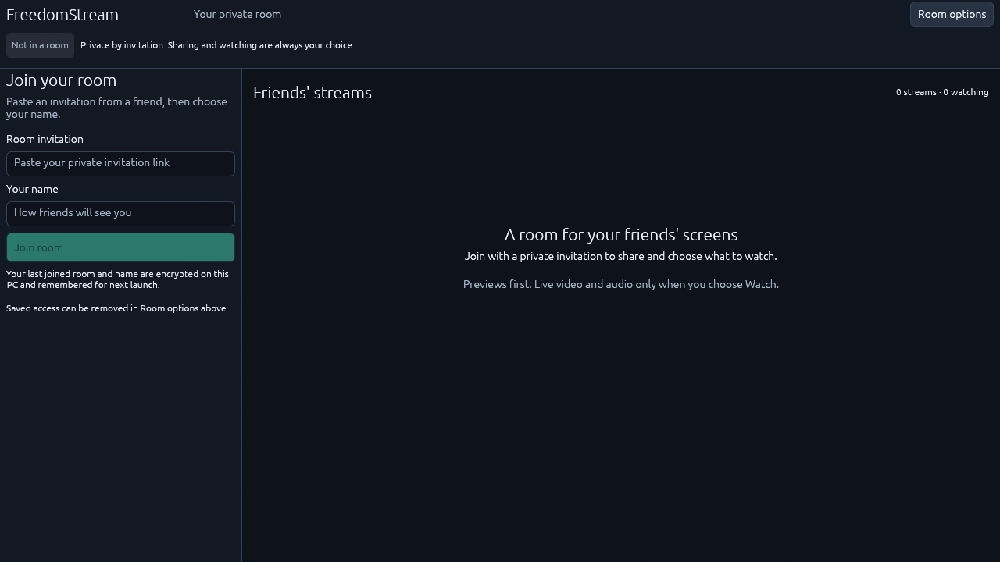

# Implementation pass 1

Felipe requested that findings be checked before implementation, then narrowed
Gemini's future reviews to visual design and UX inferred from screenshots.
Round 1's numeric values below are supplemental static baselines, not hands-on
scores. See [finding validation](round-01-validation.md) for corrections to the
original recommendations.

| Category                          | Gemini baseline | Verified changes in this pass                                                                                                                                                                                                  |
| --------------------------------- | --------------- | ------------------------------------------------------------------------------------------------------------------------------------------------------------------------------------------------------------------------------ |
| Visual design                     | 6.0             | Explicit dark navy surfaces, consistent typography/borders/rounding, readable muted text, full-width aligned fields and larger secondary controls.                                                                             |
| Layout and responsiveness         | 6.5             | Four-card grid fits the wide viewport; watched controls share the video footprint. Narrow layouts keep a readable full-width stream and explicit scrolling. Main sharing actions stay anchored outside the scrolling form.     |
| Room onboarding                   | 5.5             | Joined identity, room presence menu/count, room-level saved-access options, masked invitation input, Enter submission and visible Cancel join. Cancellation now preempts native network stages instead of only queueing Leave. |
| Sharing workflow                  | 6.5             | Visible FPS, aligned resolution/preset controls, dedicated Advanced window, active output summary, unchanged Apply disabled and pending live/restart cues. Bitrate and codec remain in Advanced as Felipe requested.           |
| Watching workflow                 | 6.5             | Preview/Live badges, compact Stop/Focus/Mute/volume overlay, percentage volume, remembered unmute level and Escape back to the grid. Explicit subscription behavior remains in the playback layer.                             |
| Feedback and recovery             | 5.5             | Sticky error/status area, named operations, human-readable connection badge, Copied confirmation and separate saved-access errors.                                                                                             |
| Accessibility and discoverability | 5.0             | Larger targets, explicit label associations, more legible text, clear names/units and Enter/Escape actions. Image review assesses visible accessibility only; keyboard/screen-reader compliance is not certified.              |

## Validation and limits

- The parent's source and image audit rejected a button-only join cancellation
  fix and the proposed main-panel bitrate display. The former required controller
  cancellation; the latter contradicted Felipe's Advanced-only preference.
- Native formatting/Clippy checks passed, as did 7 portable and 28 native unit
  tests, including prompt cancellation, late-result cleanup and a stale join that
  must never begin network work. Final clean-build checks are recorded on the PR.
- A separate native image pass exposed and corrected narrow thumbnail sizing,
  live control overflow and sharing-action clipping before the next Gemini review.
- Capture hooks and state overrides are temporary and are removed from production
  source. No browser, server API, bitrate default, audio capture policy or preview
  cadence change is introduced by the visual refinements.

## Images for the next independent review

The [pass 1 gallery](images/pass-01/) contains native renderer screenshots.
Color bars are synthetic stream content, not proposed app artwork.

`streams`, `one`, `narrow`, `watching`, `focus`, and `advanced` use an isolated
authenticated room with synthetic publishers. `onboarding`, `joining`, `error`,
`empty`, `sharing`, and `dirty` include deliberate demo-state overrides to expose
the corresponding UI affordances. These pictures establish visible design and
inferred UX, not execution of the simulated workflows. Participant counts can
vary while capture clients enter/leave the local room.

