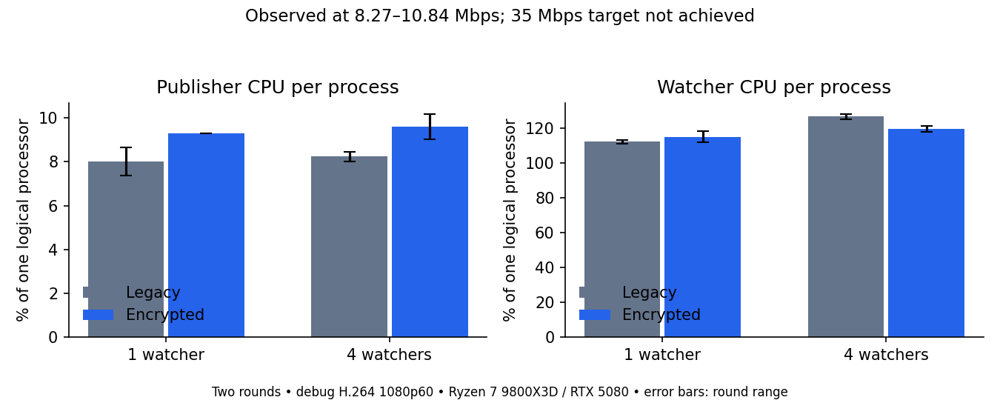

# Native invitation encryption verification

Date: 2026-11-10. Branch: `feat/native-room-e2ee`, based on
`0d16ce85a4408209a49975da1d36ddff6c652d14` (`origin/main`). This PR is explicitly
not authorized for merge or deployment.

## Scope and review gate

The pre-implementation GPT-6.1-Sol high-reasoning review approved proceeding with
conditions for invitation-holder confidentiality. The [design](../native-e2ee.md)
states the limits: no human/device identity, FS/PCS, full replay protection or
malicious-server-resistant revocation of a known root. Implementation review and
real-media results are separate gates.

An organizer creates/replaces private invitation material in the native app.
Guests keep paste-and-join. Legacy invitations remain unprotected. Only the
admission credential enters API requests. Server-side preview storage is opaque.

## Runtime changes requiring verification

The pinned SDK setup adds strict checks that an SFU TrackInfo cannot downgrade the
client's requested encryption before sender activation. Native audio/video pumps
wait until publication and GCM cryptor readiness. The SDK closes a protected full
reconnect without republishing under retained keys; native recovery must create
fresh admission and sender-session material. Source/codec replacement retains the
protection requirement. Source inspection is not packet-level nonce telemetry.

`deploy/native-sdk.json` pins upstream archive, all five patched source files and the
whole generated SDK tree. The original checkout's generated decoder differed
from this branch's pins, so this worktree generated its own SDK from the verified
archives. Builds use a short target path to avoid Windows dependency-extraction
path limits. The GStreamer runtime is the existing verified local runtime.

## Automated checks

- Node 24.11.1 `npm run check`: passed (42 server/API, 23 web and 4 configuration
  tests, plus formatting, types and builds). Includes
  protected envelope API admission, publication proof, exact MIME, bounds,
  cadence across format changes, stopped-stream cleanup and unchanged legacy JPEG
  rejection behavior.
- `node --test scripts/native-tools.test.mjs`: 3 passed, including tampered
  archive/generated source rejection.
- Native formatting, Clippy and 41 publisher + 7 portable tests passed on the final
  hardened source, including
  Windows DPAPI protected invitation save/restore, root absence, tampering and
  Forget. The debug acceptance executable SHA-256 is
  `10513f0829f47b8099d24d123378f064dafc0aacf6ffe49e030c4e3511806f76`.
- Real local SFU `e2ee.spec.ts` + `e2ee-faults.spec.ts`: **11 passed** on the
  hashed binary above, using the RTX 5080. H.264, HEVC and AV1 native playback,
  encrypted JPEG previews, actual Stop/rewatch byte checks, AV1-to-H.264 fallback,
  stereo game audio with Discord exclusion, wrong/missing-root denial, legacy
  plaintext denial, descriptor tampering/removal and both signaling faults passed.
  The H.264 sender and receiver actively tried disabling their cryptors; both
  remained enabled and encrypted playback continued.
- `node scripts/test-sdk-receiver.mjs`: **1 passed**, deliberately overlapping
  same-SID publication attachments while the first notification is blocked. It
  runs the pinned SDK's real track/publication implementation in a separate
  generated test workspace, without modifying the app manifest or lockfile.
- Opt-in real-media CPU measurement: **1 passed**, eight scenarios across two
  alternating-order rounds. Its achieved bitrate falls short of the requested
  35 Mbps; see the measurement below before interpreting the CPU results.

## CPU measurement and its throughput limit

The local debug build used a Ryzen 7 9800X3D (16 logical processors), RTX 5080,
D3D11 snow fixture and H.264 1920x1080 at 60 fps. A publisher and one or four
independent native watcher processes ran on the same machine. Each scenario
excluded the first 20 seconds, then sampled process CPU time over approximately
eight seconds while viewers remained subscribed. Eight one-second sender metrics
were captured inside each CPU window. The receiver allowance was 200 Mbps.

**The 35 Mbps encoder target was not achieved.** Actual window delivery averaged
8.27–10.84 Mbps across scenarios, at about 60 fps. Consequently this does not
qualify CPU overhead at 35 Mbps, or at 35 MB/s (280 Mbps). The earlier end-of-run
delivery statistic is retained in the raw report for transparency but is not used
to describe throughput during CPU sampling.

The table shows means across two alternating-order rounds. CPU units are percent
of one logical processor: 100 means one fully occupied logical processor, rather
than 100% of the whole machine. Watcher values are per process.

| Watchers | Publisher, legacy | Publisher, encrypted | Watcher, legacy | Watcher, encrypted |
| -------- | ----------------: | -------------------: | --------------: | -----------------: |
| 1        |              8.02 |                 9.29 |          112.21 |             115.05 |
| 4        |              8.23 |                 9.61 |          126.69 |             119.57 |

The publisher increment was small in this fixture. Watcher differences changed
direction with concurrency, so these short, noisy runs do not isolate an accurate
decryption cost. They do not justify a claim that encryption is unnoticeable while
gaming. Four watcher processes receiving one stream are not four streams decoded
in one application. No latency, game-frame-time or release-build result is implied.
Use the [raw measurements](native-e2ee-cpu.json) to inspect each round and its
actual bitrate. Performance binary SHA-256:
`4f9ba4ae61f0c62555a5f08923b78b03f5ab395957eb12aadcf398b85ef31e81`.
It differs from the acceptance binary only by fixture rate diagnostics.

Reproduce using Node 24, a configured local SFU and the native debug executable:
set `FREEDOMSTREAM_NATIVE_EXE` to that executable, set
`FREEDOMSTREAM_MEASURE_E2EE=1`, then run
`node --env-file=.env scripts/native-room-smoke.mjs e2ee-performance.spec.ts`.
Sustained 35 Mbps performance remains an explicit qualification gate.

## External and unverified gates

Do not infer an AMD GPU result from this machine's RTX 5080. Physical game impact,
multiple independent friends publishing into one receiving app, network/device
audio timing, fresh-PC/offline distribution and 4K120 are not established by this
phase's local tests. No new portable release or deployment is implied.

The two `e2ee-faults.spec.ts` real-SFU tests passed: fault-injected outgoing
GCM-to-None negotiation was refused; a backend-minted identity and replayed public
descriptor plus forced plaintext subscription and None-to-GCM metadata delivered
RTP bytes but zero decoded video, audio or pictures. Full
packet-level key/nonce collision instrumentation and complete replay/liveness
protection are not claimed. Record which reconnect paths were actually exercised.

## Independent implementation review

The first independent implementation review requested changes to `a77ddb0` for a
plaintext receiver bypass: mutable None-to-GCM signaling could label a receiver
protected without attaching its cryptor. `6997147` added mandatory SDK receiver
cryptors and an actual-readiness gate; real malicious-signaling tests passed.

Re-review found a two-read receiver race. `c1e8621` captures the receiver once and
also refuses remote descriptors targeting the local sender key slot. A subsequent
focused review traced overlapping same-SID SDK callbacks which could still
associate readiness with another receiver. The final SDK patch serializes each
publication's attachments and exposes its receiver only after the synchronous
subscription callback completes. A dedicated regression test overlaps two
attachments while the first callback is blocked; it passed against the real SDK
track/publication implementation.

The next review found that removal/recreation could clear the notification
callback before an in-flight attachment ran it. Mandatory cryptor setup now runs
directly in `RemoteParticipant::add_subscribed_media_track`, before enabling the
receiver or adding/exposing its publication. The Room notification callback no
longer owns encryption setup. Thus a removed callback or stale publication cannot
produce an untransformed receiver. The exact retirement/RTP race is source
reviewed rather than deterministically reproduced.

Reattachment of an already playing actual receiver exposed another temporary
pass-through: packet-timing setup installed a standalone transformer, then a new
cryptor was initially disabled. The C++ wrapper now enables cryptors before
attachment and refuses disable requests for their lifetime, including cleanup.
Protected SDK paths suppress standalone timing transforms and their advertised
trailers. The H.264 media fixture actively requests sender/receiver cryptor
disablement and requires it to remain enabled while encrypted playback succeeds.
The final fresh GPT-6.1-Sol high-reasoning review approved implementation commit
`351c6df62c743ddce1b740ae1470a63302bb30c2` for the documented boundary. It
independently verified both generated source-tree hashes and the patched C++
cryptor hash. Approval is source-based and does not substitute for the recorded
runtime checks.

The reviewer identified a nonblocking future integration constraint: SDK
`publish_timing_events()` and `subscribe_timing_events()` lazily install standalone
transformers. Neither has an application callsite. Future instrumentation must
preserve mandatory encryption rather than invoke these helpers on protected
tracks without an enforcing chain.

Optional upstream hardening remains separate: the C++ cryptor's malformed short
frame parsing has unchecked indexing/subtraction in the supplied source. Review
established a crash/large-allocation concern, not content or key disclosure. This
is not a claim of a comprehensive upstream runtime audit. Operator denial of
service is outside the stated confidentiality model.

Review approval is evidence about the stated scope, not a guarantee that all
software vulnerabilities have been eliminated.
