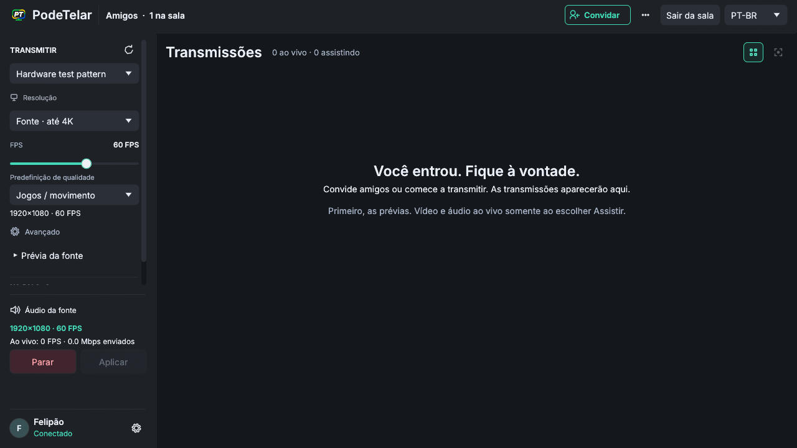
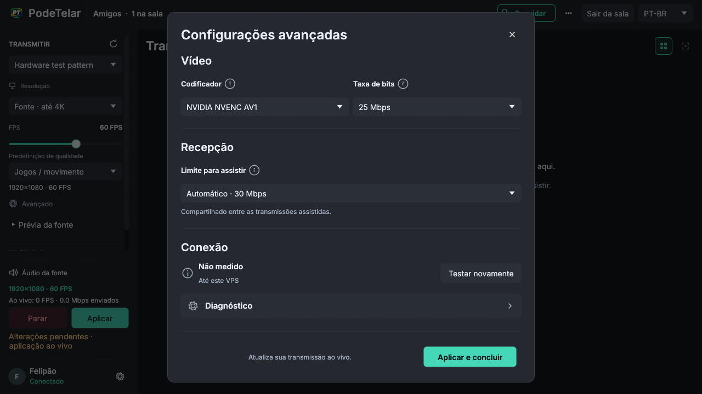
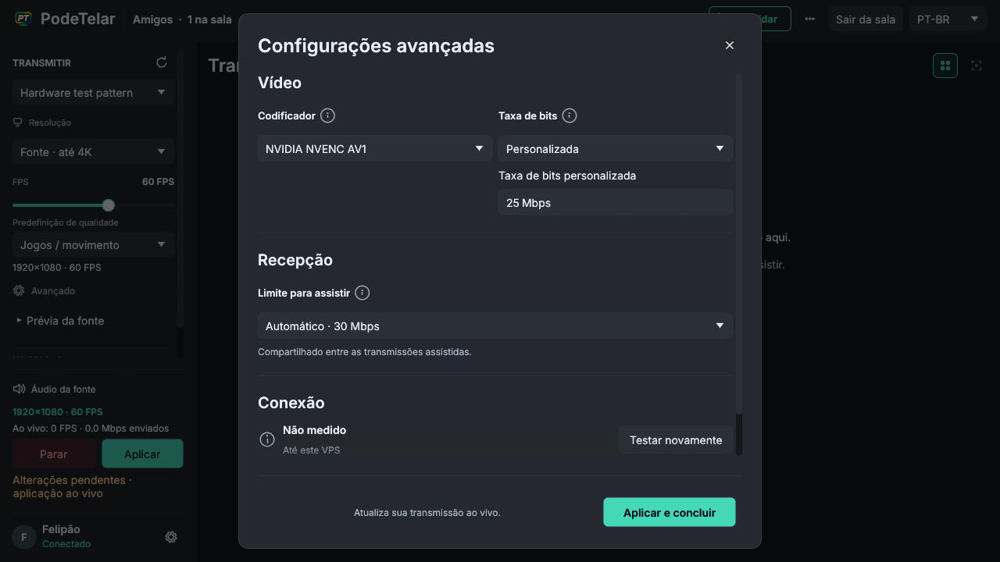
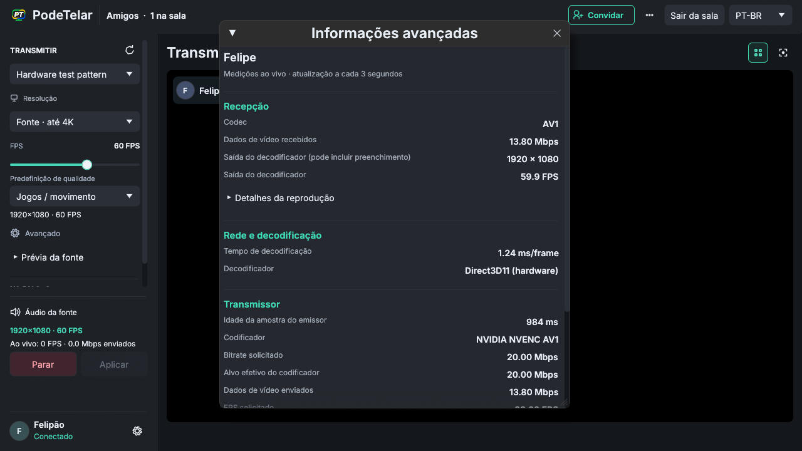
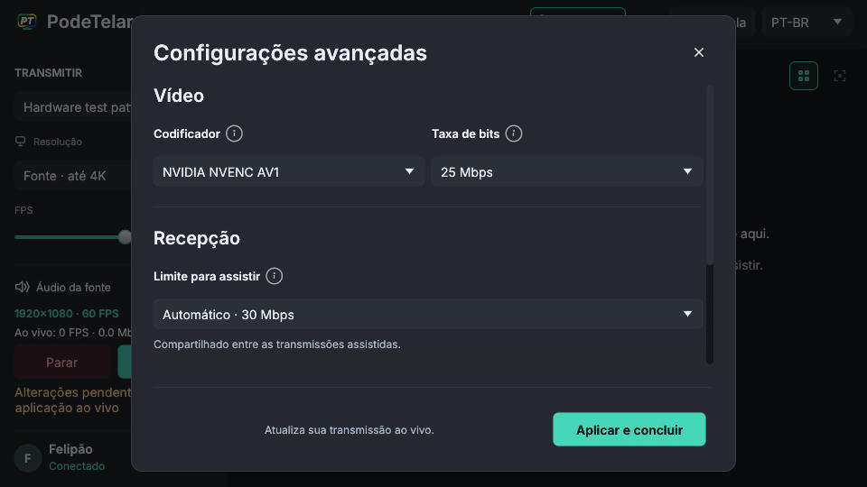
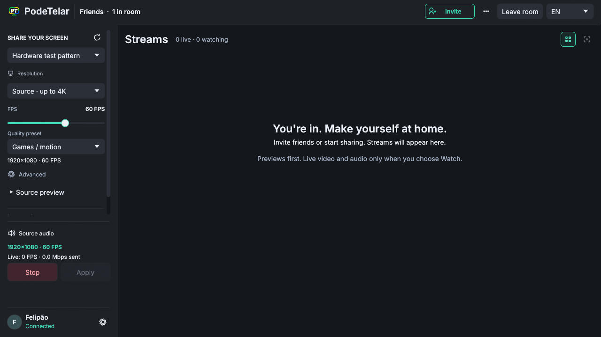

# Native UI and Discord room naming corrections

Verified on Windows on 2026-11-13. The correction branch is based on the existing
native audio work (PR #40); this change does not qualify or deploy that pilot.

## Behavior

- The native gear uses a connected, consistently scaled vector outline. The
  sidebar reserves a fixed-width identity area so the gear stays at its right
  edge; nickname text truncates and the connection status remains visible.
- The room label aligns left immediately after the brand separator. Only the
  legacy `Friends` placeholder translates to `Amigos`; custom room names remain
  unchanged. New Discord rooms use the invoking member's server nickname,
  global display name or username, then their ID as an older-payload fallback.
  Names strip control/format characters, fit the 60-character room contract and
  preserve Unicode surrogate pairs.
- Changed live selections show **Apply and close** / **Aplicar e concluir**.
  Confirmation dispatches the existing validated `Command::Apply`. Idle or
  unchanged confirmation only closes. Busy and invalid selections cannot apply.
  Bitrate/profile changes use the existing live path; mode/source/encoder changes
  keep the existing restart path. Reception allowances retain their immediate
  application behavior.
- Advanced stream information separates Reception, Network and decoding, and
  Sender. Labels use smaller muted text; values use stronger text. Playback
  internals, encoder/transport counters and measurement notes are collapsible.
  Missing/stale data and physical-presentation limits remain explicit. The
  sampling worker, demand leases, subscriptions and preview cadence are unchanged.

## Verification

- `npm run check` using local Node **24.11.1**: formatting, types, API tests and
  builds passed on the final rerun (**72 tests total**).
- `npm run native:check`: Rust formatting and Clippy passed.
- `npm run native:test`: publisher **77 passed, 5 ignored**, including the new
  modal-button test for live changes, unchanged live, idle, busy and invalid
  selection. Other workspace tests passed. Ignored physical-source tests remain
  ignored; this correction does not claim their acceptance.
- Signed **real HTTP** Discord tests pass for `/stream` and `/telar`, with name
  precedence, null/blank fallbacks, stripped controls, bounded names and emoji
  boundary cases. Admission returns the selected room name. Existing signature,
  guild authorization, replay/restart and quota cases continue to pass.
- `npm run native:room-smoke -- native-e2e/advanced-settings.spec.ts`: **2 passed**
  against the isolated Windows SFU/API. Actual hardware AV1 and H.264 publications
  accept a requested 20-to-12 Mbps change, preserve their publication SID, encode
  more than 60 frames and stop cleanly. Effective encoder targets stay positive
  and at or below the new target; congestion can reduce them further. An initial
  exact-effective-target assertion failed for AV1 at 9.095 Mbps and was corrected
  to distinguish requested mode from network-constrained effective rate. A direct
  attempt against the existing Docker SFU timed out during media connection;
  the isolated Windows SFU runs provide the successful native media evidence.
- Independent GPT-6.1-Sol, high-reasoning source review approved after fixing the
  Unicode boundary and limiting translation to the legacy room placeholder.
  A fresh final source/visual review approved the subsequent layout adjustments.
- `cargo clippy --locked -p freedomstream-publisher --example ui-review --features
ui-review -- -D warnings`: passed for the native capture helper.

## Sidebar and bitrate follow-up

The sidebar mode summary now omits the redundant SDR label. Advanced bitrate
selection keeps Automatic, followed by 6, 8, 10, 12, 16, 20, 25, 35, 50, 75 and
100 Mbps, then Custom. Presets do not show a second input. Custom shows only the
word Custom in the selector and exposes the editable number below, including
when that number equals a preset. Choosing a preset or Automatic hides the field.
The existing 1–100 Mbps input/model limit remains unchanged.

Independent GPT-6.1-Sol high source review approved this follow-up. The full Node
24 check passed. Isolated native tests passed (publisher: 77 passed, 5 ignored).
Native validation used an isolated checkout of the UI branch because concurrent codec edits in the shared workspace temporarily
made a mixed-source test build fail. These codec edits are outside this PR.

## Native renderer captures

These are **fixture layouts rendered by the actual native egui/Glow application**,
not HTML mockups or proof of live room state. Values and names are deliberately
synthetic. The helper never admits a room or starts capture/publication. Full
mouse-driven acceptance is unavailable because both computer-use entry points
reported the missing native pipe. Real media acceptance above is separate from
these layout captures. A production Discord user invocation has not been repeated.

To reproduce, build `cargo build --locked -p freedomstream-publisher --example
ui-review --features ui-review` with the configured native runtime. Run the GUI
example with `room`, `settings` or `information`, followed by a **new absolute JPEG
path**. Add `--custom` to expose the Custom bitrate field in settings. Add
`--english` or `--narrow` for EN or 960×540; defaults are PT-BR and
1280×720. The helper requests a native framebuffer capture and exits automatically.
Run commands through hidden noninteractive processes as required by AGENTS.md.
