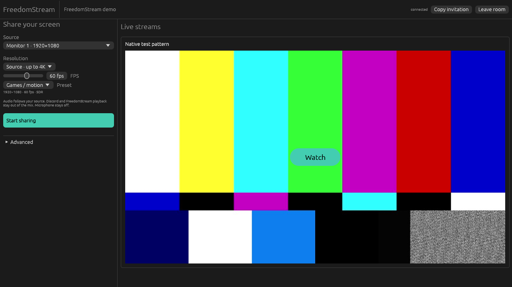
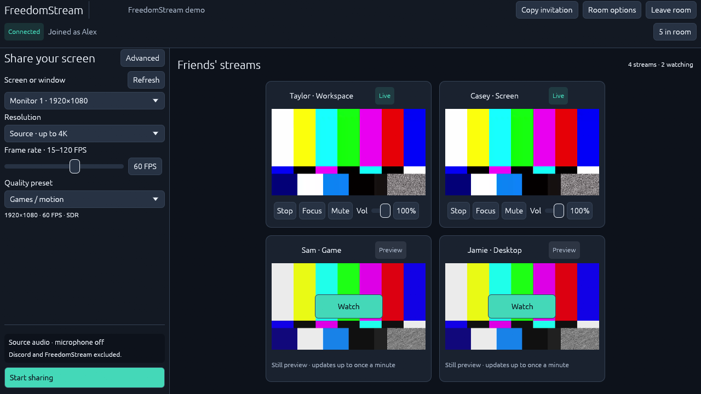

# Native rooms: local verification

Branch: `feat/native-rooms`, stacked on the portable distribution branch
`feat/native-app-experience` (PR #9). This is a draft feature, not a production
release or a completed hardware/field qualification. Checked on November 9, 2026.

## Evidence

| Check                       | Result                                                                                                                                                                                                                                                               |
| --------------------------- | -------------------------------------------------------------------------------------------------------------------------------------------------------------------------------------------------------------------------------------------------------------------- |
| Node 24 `npm run check`     | Passed formatting, TypeScript, API/unit tests and production builds.                                                                                                                                                                                                 |
| `npm run native:check`      | Passed formatting and application Clippy checks. Pinned upstream SDK warnings remain upstream.                                                                                                                                                                       |
| `npm run native:test`       | Passed 7 portable and 26 native tests, including real Windows DPAPI round-trip, atomic replacement, ciphertext storage, tamper rejection and forgetting.                                                                                                             |
| `npm run native:room-smoke` | All 8 passed against a checksum-pinned Windows LiveKit 1.13.11 SFU and isolated API/database.                                                                                                                                                                        |
| Native HEVC / H.264         | Actual NVIDIA-generated 1080p60 pattern decoded by the native D3D11 adapter; decoded frame sizes/counts and RTP advancement verified. This is not AMD or physical 4K120 qualification.                                                                               |
| Compatibility               | H.264-only watcher triggers shared HEVC→H.264 replacement and resumes native decoding with its Watch intent preserved.                                                                                                                                               |
| Selective traffic           | Video/audio subscription bytes stop after explicit Stop watching; rewatch resumes. Still previews carry no full-stream RTP.                                                                                                                                          |
| Audio                       | Actual WASAPI game capture, Discord/owned playback rejection, process restarts and stereo native SFU playback passed. Multiple native instances are excluded to prevent feedback; separate regression checks tone amplification stays below 0.03 for a 0.02 fixture. |
| Reconnect                   | Native frame advancement resumes after a full reconnect. Unwatched still is delivered again after a recorded recovery event without another publisher capture.                                                                                                       |
| Receiver allowance          | A 5 Mbps aggregate allowance caps the shared video target to at most 3.494 Mbps while preserving requested 1920×1080/60 FPS. Real constrained-network qualification remains open.                                                                                    |
| Native layout               | Actual 1280×720 native viewport inspected: left sharing controls, visible FPS slider, wide right stream region. Thumbnail/Watch and reopen checks are recorded separately below.                                                                                     |
| Independent review          | New GPT-6.1-Sol high-reasoning review approved the code for a draft PR after fixing pending-join form edits and invisible GUI startup errors.                                                                                                                        |

Local ignored logs include `native-settings-tests.log`,
`native-settings-check.log`, `native-settings-node-check.log`,
`native-room-smoke-settings-final.log` and `native-audio-feedback-final.log`.
They are execution evidence, not fixtures committed with room authority.

## Launch and packaging follow-up

Both launcher and native publisher declare the Windows GUI subsystem. The portable
qualification script verifies both PE subsystem fields. Helpers set hidden-window
flags. The pinned local test SFU now stays at one versioned path, verifies its
executable hash, and refuses to reuse occupied acceptance HTTP ports.

The committed source produced
`freedomstream-windows-x64-0.1.0-0e073b0fddad.exe` (81,574,839 bytes,
SHA-256 `4a07da68ddd4bc263060b976722cab71be3ef4b2b1a0ea6b363c10d0742dcb69`).
`qualify-portable.ps1` passed isolated-path/concurrent extraction, installed and
bundled CRT probes, payload/source integrity, modified-cache preservation,
explicit extraction, damage rejection and both GUI PE checks. Logs:
`native-rooms-package.log` and `native-rooms-portable-check.log`.

The complete eight-test native SFU suite also passed using that portable EXE,
with its launcher-isolated shipped media runtime, not the development DLL/plugin
path. The separate renamed Game/Discord tone fixtures use the extracted publisher
binary and the developer fixture environment. This checks actual packaged native
HEVC/H.264 decode, fallback, stereo/owned-instance audio rejection, subscription
traffic stopping, reconnect/preview restoration and receiver budget propagation.
See `native-rooms-packaged-media.log` (8 passed in 3.1 minutes).

The actual native GUI process was started, terminated and started again using a
DPAPI-encrypted synthetic profile in an isolated LocalAppData directory. The
SFU verified a new participant identity with the saved name on each launch, with
zero published tracks. Ciphertext contained neither the invitation nor the name.
`native-profile-autojoin.log` reports two successful joins. The initial profile
was seeded through Windows DPAPI; first-time saving via a manual form interaction
was not exercised. Store save/replace/forget uses the actual API tested above.

A Windows Security dialog naming the local `livekit-server.exe` prevented the
interactive thumbnail/Watch check. Felipe explicitly authorized Allow and future
development permissions. The tool cannot target the dialog's PickerHost window,
and the session lacks administrator rights for equivalent firewall configuration.
No firewall settings were changed. The test SFU is not in the portable client.
See [distribution](../distribution.md#saved-room-and-launch-behavior). Physical
UI click/reopen observation remains separate from the actual server-observed
native autojoin result.

## Native UI screenshot

A subsequent capture pass corrected vertical stream-card stacking inside the grid
and removed a play glyph missing from the bundled font. The portable artifact
recorded above predates these cosmetic corrections. This image is the actual
native renderer's 1280×720 framebuffer with an authenticated synthetic preview;
it excludes external OS dialogs. The temporary capture hook is not shipped.

## Native UI refinement completion

Application commit `e49728f` completed the requested image-only refinement loop.
A fresh Gemini 4 Argon context viewed fifteen actual native-renderer screenshots
and independently scored all seven fixed categories **9/10** in Round 6. The
parent verified its pixel preflight and findings before accepting the result.
Earlier reports, scores, rejected claims, implementation changes and screenshots
are preserved in the [UI review progress record](../ui-reviews/README.md).

Fresh GPT-6.1-Sol high reviews found and resolved pre-join Advanced access and
short-window playback-control overflow, then approved those fixes and the final
pinned audio footer. The latest code passed native formatting/Clippy, **7 portable
and 28 native tests**, the full Node 24 project check and a normal clean build.
Watched screenshots used actual local native subscriptions; selected lifecycle
screens used documented UI fixtures. All temporary capture hooks were removed,
and the local runtime executable was updated from the clean build.

The portable evidence earlier in this document is from `0e073b0`. The subsequent
user-authorized [friends beta delivery](friends-beta.md) packages the final UI
plus an independently verified NVIDIA Broadcast exclusion correction as `a4eb88e`.
Its portable checks and all eight packaged native media tests passed; the VPS
serves that EXE with the compatible server and 256KiB preview proxy. The delivery
record distinguishes complete checks, bounded production observations and
remaining limitations. Interactive first-join saving and the external acceptance
gates below remain separate from visual ratings and beta deployment.

## Open acceptance gates

AMD encode/decode; a fresh PC and disconnected startup; real games/Discord with
simultaneous publishing and multiple subscriptions; synchronized A/V latency and
render performance; native TURN/TLS under blocked UDP; physical 4K120; and a full
friends' evening/group network/resource run remain unqualified. No compile result,
synthetic frame count or bitrate guide replaces these checks. No merge or release
is authorized by the local results alone under the phase acceptance policy.
