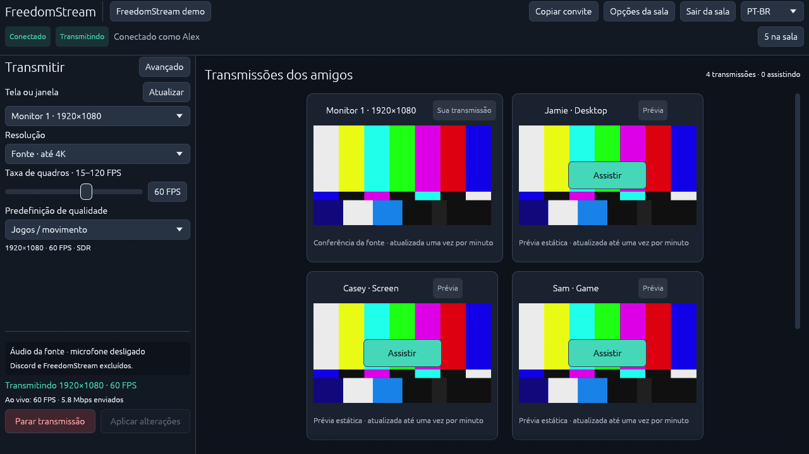

# Friends feedback: bandwidth, room UI and language

Follow-up branch: `feat/native-room-feedback`, based on the native-room beta
(`a916b6d`, PR #10). This work is not deployed and does not replace the friends-beta
executable. The existing production invitation and credentials remain private.

## Changes

| Request                          | Implementation and limits                                                                                                                                                                                                                                                                                                                                    |
| -------------------------------- | ------------------------------------------------------------------------------------------------------------------------------------------------------------------------------------------------------------------------------------------------------------------------------------------------------------------------------------------------------------ |
| Automatic internet test          | On native room connect, an independent task measures download then upload to the room's VPS. Advanced offers a rerun. Payload pacing is capped at 100 Mbps; this measures the path to this server, not an ISP maximum.                                                                                                                                       |
| Watching allowance               | Automatic allowance uses 80% of measured download; the receive controller reserves a further 25% for overhead and 256 kbps per audio subscription. Insufficient capacity can pause watching. Manual allowances remain explicit. Failed reruns retain last available measurements with a warning.                                                             |
| Upload recommendation/adaptation | Upload ceiling is 80% of measured upload minus 256 kbps for audio. Encoder target is the minimum of requested quality, upload ceiling, transport feedback and active viewers' per-stream limits. Limits update as actual watch intent changes; room members who are not watching do not lower quality. Increases ramp; resolution/FPS never change silently. |
| Room members                     | The room-name menu lists the local user and names of remote media-room participants, including those not sharing.                                                                                                                                                                                                                                            |
| Own source preview               | A first tile shows the active source name and cached still image. It has no Watch/subscription or playback controls. It shares the existing JPEG cache; capture remains once at start and at most once per minute. Stop/leave clears the snapshot reference.                                                                                                 |
| Room menu                        | Removed the two explanatory lines requested by Felipe. Retained Advanced, Forget saved room and packaged library notices.                                                                                                                                                                                                                                    |
| Visible statistics               | The sharing footer shows configured geometry/FPS and measured encoded FPS/sent Mbps. More diagnostics remain in Advanced.                                                                                                                                                                                                                                    |
| PT-BR                            | PT-BR and English switch from the top-right selector. Language is saved separately from encrypted room authority. Names, source titles and codec brands are not translated.                                                                                                                                                                                  |
| Slight audio lag                 | Wired output was reported by Felipe. Added capture-age, audio submission-wait and playback-backlog counters. Investigation is recorded below; no synchronized-playback fix is claimed.                                                                                                                                                                       |

One encoding is shared by all viewers. A slow active viewer can therefore reduce
quality for everyone watching that publisher. Lower bitrate cannot guarantee smooth
playback on an overloaded encoder/decoder or a changing network.

## Probe boundaries

Routes are room-scoped and authenticate before reading upload bodies. Probe tokens
are memory/header-only. Transfers are not cached or compressed. One global lease
serializes tests; session/IP cooldowns and bounded maps limit repeated work.
Each direction has a 24 MiB ceiling, a normal approximately two-second payload
window, and a six-second server connection deadline. Normal native uploads are
paced too. Leave/rejoin cancels the task, and a best-effort DELETE releases its
lease; expiry/revocation are independent server backstops.

The 100 Mbps ceiling describes paced application payload. TCP/TLS overhead and
buffered bursts exist; server application pacing is not host-level shaping against
an adversarial uploader. Reruns can compete with active streams. Production nginx
must disable request buffering and allow 24 MiB only on the upload-test route;
preview/API limits remain separate.

## Evidence collected

- Node 24.22.2 `npm run check`: formatting, types, API tests and builds pass.
- Native formatting/Clippy pass. Native unit tests pass, including low measured
  capacity and independent upload/viewer/transport limits.
- Real TCP server test passes early unauthenticated-upload rejection, concurrent
  lease refusal, paced download, bounded upload result, cooldown, stale token,
  aborted download cleanup, six-second stalled-upload deadline, and revoked
  session/lease recovery. These are actual HTTP transfers, not injected body mocks.
- Native reqwest diagnostic against an isolated local server measured
  43,202,498 bps download and 99,692,507 bps upload; automatic allowance was
  34,561,998 bps and upload video ceiling 79,498,005 bps. This is one local debug
  run, not a VPS/network qualification.
- A real H.264 1080p60 publisher and two native watchers exercised 25 Mbps and
  3 Mbps allowances. The 3 Mbps viewer advertised a 1,994,000 bps video cap; the
  hardware encoder applied it by the following sampled second. Stop/resume
  removed/restored that constraint, and after the slow watcher departed it ramped
  back to the requested 8,000,000 bps by second 37, while averaging approximately
  60 FPS. Both clients received native frames. See the sanitized
  [one-second encoder trace](phase-12-watcher-rates.csv). This used local SFU/media,
  manual viewer allowances and synthetic content; it does not qualify WAN loss,
  physical A/V synchronization or the automatic probe under media load.
- A second GPU run applied a fixture upload ceiling of 3,000,000 bps before
  capture started. All encoder samples stayed at or below that ceiling; the
  slow watcher still reduced it to 1,994,000 bps, and its departure never bypassed
  the upload ceiling. This verifies the startup/minimum-cap seam with a supplied
  limit, not a measured slow-WAN upload.
- Native-renderer screenshots inspected in PT-BR and English, 1280×720 and
  960×540. Synthetic publishers supply the images. Self-sharing mode and its
  60 FPS/5.8 Mbps statistics are controlled UI fixtures; they do not qualify
  physical monitor capture or measured encoding performance.
- A five-second controlled application-audio capture produced 240,480 stereo
  frames. Mixer-output PTS age was 7.56 ms in the last sample and 27.97 ms maximum.
  The 440 Hz source tone was detected; the separate native-playback 1320 Hz tone
  remained below the fixture's 0.001 threshold. This exercises the new capture-age
  counter and own-playback exclusion on this setup, not sender-to-speaker latency.

[English](images/phase-12/english.png) ·
[Advanced](images/phase-12/advanced.png) ·
[Room actions](images/phase-12/room-options.png) ·
[Short viewport](images/phase-12/short-self.png) ·
[Onboarding](images/phase-12/onboarding.png)

## Audio timing investigation

Independent read-only review checked the pinned native headers and SDK bridge.
Remote video `timestamp_us` is a local render deadline, despite the Rust field's
capture-time wording. The app currently presents decoded pictures immediately.
However, WebRTC prerender smoothing can already account for most of that delay;
the remaining callback-to-presentation lead is unmeasured. Upstream
[decoder source](https://webrtc.googlesource.com/src/+/refs/heads/main/modules/video_coding/generic_decoder.cc)
corroborates the semantics but is not asserted to match the pinned binary.

The custom audio output uses WebRTC's synthetic audio device followed by GStreamer
and WASAPI. Output queue/device latency is not reported back to WebRTC. The capture
mixer and source also buffer audio. The audio stream's Rust frames expose no
timestamps; an available C++ optional capture-time overload would not by itself
provide a speaker deadline. Upstream
[remote audio source](https://webrtc.googlesource.com/src/+/refs/heads/main/pc/remote_audio_source.cc)
also supplies no capture time on that path.

The new counters measure pipeline backlog, not physical A/V offset. No constant
video delay was introduced. Switching directly to `PlatformAudio::new()` is unsafe
for this product: it enables recording as well as playout and lacks the required
Rust per-track gain control. A future SDK seam needs explicit playout-only control
on the room runtime, per-track volume and actual device-delay integration.

## Remaining acceptance

A fresh GPT-6.1-Sol high-reasoning read-only reviewer approved code scope for
`a916b6d..68e6ebf`, with no actionable regression. That approval explicitly excludes
merge/release and physical synchronization. A subsequent CLI-fixture-only correction
preserves its supplied upload ceiling across a source/mode restart; it does not
change the GUI path.

Before releasing or merging this phase: qualify real upload/download through the
production proxy under media load, multiple simultaneous joins, changing link
capacity, rerun cancellation/rejoin, and deployment rollback. Verify own preview
against actual monitor/window switches and cadence. Qualify language persistence
on actual reopen and native keyboard/accessibility behavior.

Audio requires a synchronized flash/click fixture observed at the actual display
and wired audio output, with offsets/variance recorded at startup and steady state
for H.264/HEVC, reconnect, source switches and multiple watched streams. Compilation,
PCM tone detection and backlog counters cannot substitute for that measurement.
Existing AMD, fresh-PC and real-game/Discord/4K120 gates also remain open.
