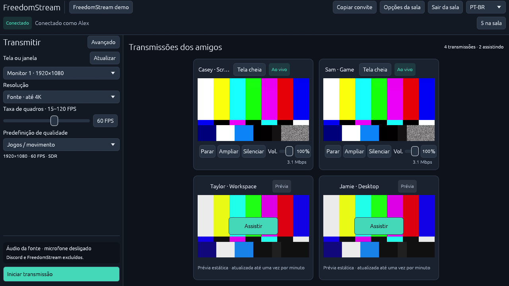

# Fullscreen, 200 Mbps probes and game-performance work

Branch `feat/fullscreen-stream-performance` builds on feedback PR #11. Development
is isolated from concurrent AV1, icon and administrator work. This phase does not
claim that those separate features are included.

## Behavior

- Watched cards have a **Full screen / Tela cheia** button. Double-clicking video
  or F11 also enters native borderless fullscreen; Escape/F11, double-click or the
  fullscreen exit control returns to the window. F11 selects the focused watched
  stream, otherwise the first watched stream. The video preserves its aspect
  ratio. Controls and the fullscreen bitrate label hide after three seconds without input, including when the
  cursor rests over a control. Mouse movement or a fresh click/key press brings
  them back; hovering or holding a key does not keep them visible. Entering
  fullscreen closes Advanced; key repeats do not toggle it.
- Actual received **video payload bitrate** appears at the bottom right of watched
  cards and fullscreen. It uses inbound byte deltas and actual elapsed time,
  sampled approximately every two seconds. It is not the configured encoder
  target, total connection speed or an audio/overhead measurement. Reconnect resets
  the reading. Fullscreen does not change other subscriptions.
- New clients request a **200 Mbps** probe. The server retains 100 Mbps/24 MiB for
  clients without that request, while new clients also accept the old server's
  100 Mbps ticket. New tests have a 48 MiB ceiling; the dedicated upload proxy is
  adjusted to 48 MiB. Normal duration, deadlines, authentication, lease serialization,
  cooldowns and cancellation remain bounded. Encoding remains capped at 100 Mbps.
- At measured 200 Mbps, download allowance is 160 Mbps with a further payload
  reserve, enough for one 100 Mbps video plus audio and overhead. The upload video
  ceiling is approximately 159.7 Mbps before the separate 100 Mbps encoder ceiling.
  This establishes headroom to this VPS, not a guarantee against changing congestion.

## RX 7600 investigation

Felipe's friend reported game stutter while sharing the **whole monitor**, HEVC,
1080p120 and 25 Mbps. No AMD/Siege benchmark was available here. Encoding 120 FPS
processes twice as many frames as 60 FPS at the same resolution; bitrate alone
does not describe capture/conversion/encoding GPU work.

Two avoidable sources of work are addressed:

1. Publish-only/static UI previously requested repaint every 16 ms. It now requests
   every 250 ms, keeping normal input responsive through event-driven redraw.
   Hidden windows also use the slower timer. Visible watched video retains its
   fast repaint schedule. No capture FPS, resolution or subscription is silently
   changed.
2. The pinned GStreamer 1.28.8 AMF bitrate setter marks properties updated;
   `check_reconfigure` returns that flag, and the base encoder reopens its component.
   Our one-second feedback updates could therefore repeatedly reset the encoder.
   The new AMF policy applies decreases on the next normal rate update, with a
   5% margin for automatic reductions. Automatic increases wait five seconds and
   require a significant change, then ramp. Explicit bitrate edits remain responsive;
   viewer/upload/transport caps are never bypassed. Native NVIDIA behavior is
   unchanged. Advanced and CLI metrics count bitrate property changes.

These thresholds are project policy, not vendor performance guarantees. The source
establishes reconfiguration behavior, **not** that it caused this friend's hitches
or that the changes fix them on RX 7600. Actual frame-time comparison with streaming
off/on and 60/120 FPS remains necessary; retain the selected 120 FPS option.

Primary sources:
[AMF HEVC setter and reconfiguration flag](https://github.com/GStreamer/gstreamer/blob/1.28.8/subprojects/gst-plugins-bad/sys/amfcodec/gstamfh265enc.cpp),
[AMF component reopening](https://github.com/GStreamer/gstreamer/blob/1.28.8/subprojects/gst-plugins-bad/sys/amfcodec/gstamfencoder.cpp#L1150),
[GPU scaling/color conversion](https://gstreamer.freedesktop.org/documentation/d3d11/d3d11convert.html).

## Evidence so far

- Node 24 project check passed in the isolated checkout, including actual HTTP
  pacing/cancellation/deadline tests and new 200 Mbps/legacy-ticket assertions.
- Native tests passed: 34 publisher tests plus 7 portable tests. New tests cover
  received byte-rate calculation/reset, 200 Mbps headroom for a 100 Mbps video,
  AMF noise suppression, prompt cap decreases and bounded recovery.
- Native formatting/Clippy passed before renderer capture. Temporary test hooks
  are restored out of production source before packaging.
- Four synthetic native publishers and two watched native streams supplied the
  renderer captures. The fullscreen image is 1920×1080, versus 1280×720 for the
  watched grid and restored window. Native viewport state reported fullscreen
  `true`, then `false`; watch intent remained two. HUD values were actual inbound
  statistics, approximately 3.1 Mbps per watched synthetic stream.
- F11/Escape were injected as **egui test events**, not desktop keyboard input.
  Both provided desktop-control interfaces reported the native pipe unavailable.
  No hands-on click/keyboard acceptance is claimed. The screenshots verify actual
  native rendering and viewport state, not just a static mockup.

[Fullscreen](images/phase-13/fullscreen.png) ·
[Restored window](images/phase-13/restored.png)

The follow-up idle capture holds an injected egui pointer at `(80, 1050)`, over
the fullscreen controls, for four seconds. Both controls and the bitrate label
disappear; native fullscreen remains true and two watch intents remain selected.
This uses the native renderer's raw-input test hook, not desktop automation. The
temporary hook is removed from production source.

[Fullscreen after inactivity](images/phase-13/fullscreen-idle.png)

## Additional checks

- A real native request against the updated local server measured upload at
  199.1 Mbps, above the old ceiling; download measured 44.2 Mbps while builds were
  running. Capacity reflects that run's path/load, not an advertised line speed.
- The existing `39aaffe48b53` portable client completed a transfer against the new
  local server (upload 99.5 Mbps), verifying the legacy path with the actual EXE.
- Two new native clients completed concurrent tests through the still-deployed
  old 100 Mbps server. Their downloads were 56.2/100 Mbps and uploads 7.1/94.9 Mbps.
  These were native QA binaries, not the final portable package. The lower results
  are retained; no speed guarantee is inferred.
- The `9a01268` portable package passed isolated/concurrent extraction, GUI
  subsystem, runtime/payload/source integrity, fallback probe, cache preservation
  and damage rejection. Its eight actual native media checks all passed in 3.4
  minutes: HEVC/H.264, fallback, watch/stop/previews, stereo exclusion, reconnect
  and aggregate allowance. The later fullscreen-only idle change is additionally
  covered by the renderer capture above. Final portable identity is recorded below.
- Independent GPT-6.1-Sol/high review approved `9447d0b..9a01268` with no actionable
  findings and reran actual HTTP probe/configuration tests. The subsequent small UI
  follow-up removes hover/held-key keepalive and hides the fullscreen bitrate label
  on the same inactivity timer. It does not change capture, audio or admission.

Public deployment checks and delivery identity are recorded as they complete.
Physical wired A/V sync remains
open from the previous beta. AMD game/frame-time acceptance, fresh-PC behavior,
multi-GPU capture and 4K120 remain separate field gates.
